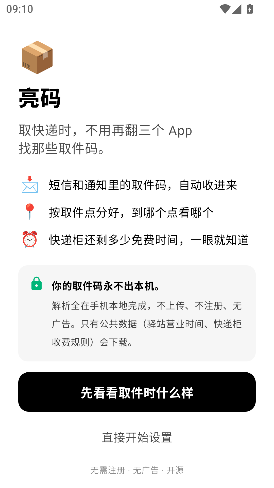
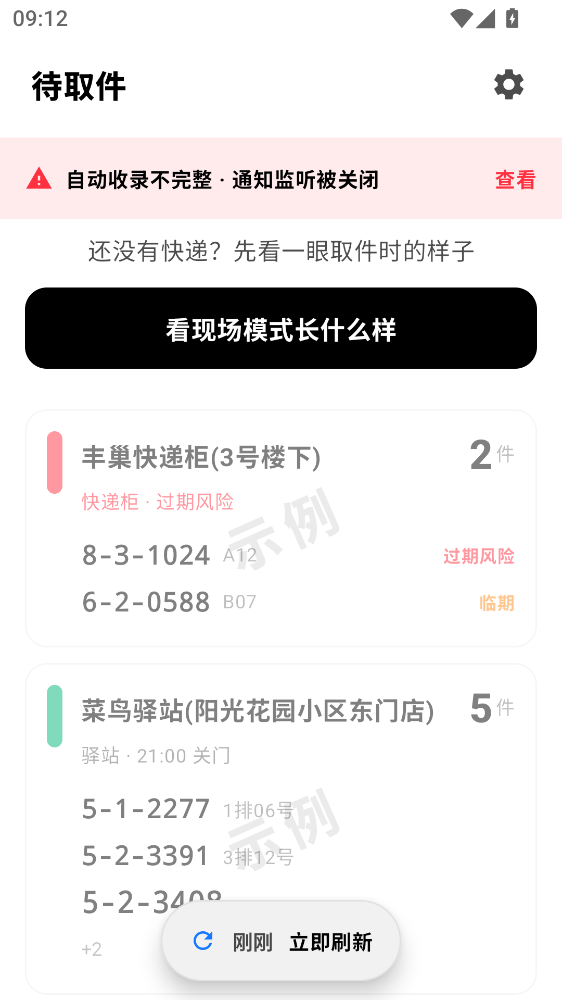
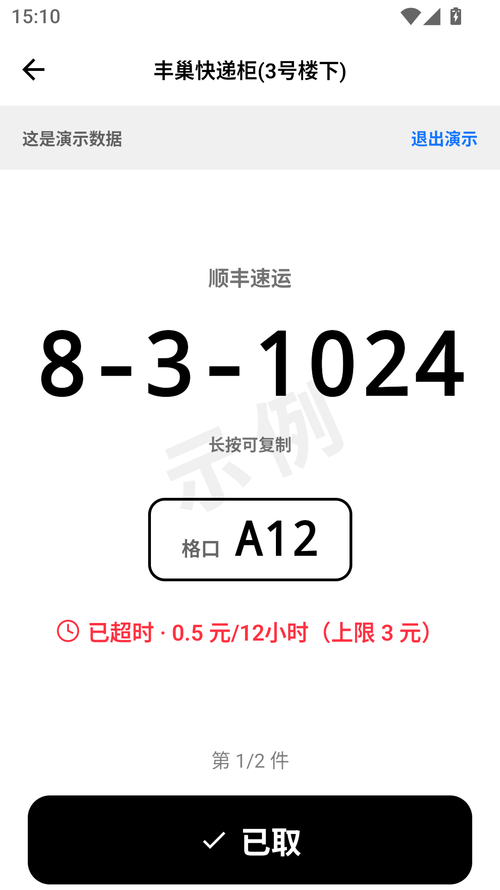

# 亮码 ShowCode

> 取快递时，不用再翻三个 App 找那些取件码。
>
> Android · Kotlin / Compose · 完全离线 · GPL-3.0
>
> [](https://github.com/sonder123i/showcode/actions/workflows/ci.yml)

**它和「快递管理 App」的区别**：那些是把取件码存起来的**档案柜**，亮码是站在柜机前用的**作战面板**。
你不需要一个漂亮的列表，你需要在 5 秒内看清「这个柜子的第几格、码是多少、还剩多久收费」。

| 首次打开 | 首页按取件点分好 | 现场模式 |
|---|---|---|
|  |  |  |

> 后两张图里是**演示数据**（带「示例」水印），首次打开时不用真收一条短信就能看到产品长什么样。

## 它做什么

- **自动收码**：监听取件短信与 App 通知，把取件码、格口/货架号、是哪个取件点解析出来。
  装完 App 会回填最近 14 天的收件箱——手机上本来就躺着的件不该让你等下一条短信。
- **取件点是一级公民**：首页第一级不是按时间排的包裹列表，而是「哪个点有几件、最急的那件什么状态」。
  卡片内和卡片间都按紧急度排序，最急的在最上面，而不是最新到的在最上面。
- **三态时效**：安全 / 临期 / 过期风险，只有三种颜色。丰巢按免费保管剩余时间
  （默认 18 小时，超时 0.5 元/12 小时、封顶 3 元），驿站按关门时间。
  紧迫度不靠加第四个色阶，靠**倒计时数字一直在跳**承载。
- **现场模式**：全屏超大取件码 + 格口号紧贴其下。字号按 `min(基准, 140/字符数 × 屏宽)` 防溢出，
  所以 12 位的码和 4 位的码都不会撑破屏幕；短信里没有格口号时那一整块**消失**、码变得更大，
  而不是留一个「--」的空位。
- **桌面组件按取件点分节**：一个组件显示所有点，点某一节一步直达那个点的现场模式。
  也可以给某个点单独钉一个组件，只显示它。
- **合并可以反悔**：同一个驿站在不同短信里写法不同，App 绝不自动合并，只提示一句
  「可能是同一个点？」。合并前给你看两边各几件、各自最近的原始写法；合并后 5 秒内可撤销，
  取件点详情里永久保留合并历史、随时拆开。拆开之后原来的名字和件数一个都不丢。
- **代取件单独成组**：妈妈经微信转发过来的码会被标成代取件，在现场模式里和自己的码分两组轮播，
  不会滑混。分组名字随你改。

## 它不做什么（以及为什么）

这一节是有意写这么长的：它同时是**取舍说明**和**issue 过滤器**。

- **不做 iOS**。不是审核问题，是平台根本没有这个 API——iOS 读不到短信正文、也读不到别的 App 的通知，
  侧载和上架一样拿不到。菜鸟、丰巢在 iOS 上也只能靠自家账号推送。
- **不做锁屏组件**。第三方锁屏小组件 Android 5.0 就被移除了。取快递时你本来就会解锁手机。
- **不做多设备同步、不做账号**。用户数据不出本机（见下一节）。
- **不自动合并任何名称不同的取件点**。后果不对称：错合并会让现场**少显示一个码**（灾难），
  不合并只是首页多一张卡片（难看）。所以宁可多一张卡，把判断交给你，但把反悔的入口给足。
- **不下载你的任何内容**。唯一会发生的网络请求是下载公共数据（驿站营业时间、快递柜收费规则），
  而且那是 V2。

## 隐私

- 解析全部在手机本地完成。不上传、不注册、无广告、无任何统计 SDK。
- 数据存在本机 SQLite（`dev.showcode` 私有目录），卸载即消失。
- 权限逐条说明，用到才要：
  - `READ_SMS` / `RECEIVE_SMS`：读收件箱里的取件码。**拒绝也能用**——手动导入是一等入口，不是施舍。
  - 通知使用权：有些驿站不发短信、只在自家 App 推通知；家人经微信转发的取件码也只能从这里进来。
  - 桌面组件：系统机制，不需要额外权限。
- 权限被系统静默收回是国内 ROM 的常态，所以首页有一条常驻的健康提示，
  而不是只在首次引导时检查一次。

## 安装

到 [Releases](../../releases) 下载 `showcode-<版本>.apk`。minSdk 26（Android 8.0），targetSdk 36。

打 `v*` 标签时 CI 会自动签名、按版本号命名，并附上 `SHA256SUMS.txt`。
**装之前对一下哈希**：这个 App 完全不联网，你没有任何别的办法确认下到的包就是官方构建的那一个。

```bash
sha256sum -c SHA256SUMS.txt   # 和 Release 页面里那份对上一致再装
```

尚未上架任何应用商店（包括 F-Droid）。仓库里已经按 F-Droid 的格式放好了
`fastlane/metadata/android/{zh-CN,en-US}/`（标题、简介、详细说明、截图、每版更新说明），
提交时缺的只有一个 512×512 的图标——现有启动图标是自适应矢量，F-Droid 的机器人不吃这个。

## 自己构建

```bash
# JDK 17
./gradlew :app:assembleDebug          # 调试包
./gradlew :app:testDebugUnitTest      # 86 个单元测试
```

打 release 包需要一个你自己的签名密钥。**密钥和口令不要提交进仓库**，两条受支持的来源：

```bash
# 1) 生成密钥（PKCS12 要求 key 口令与库口令一致，别给两个不同的值）
keytool -genkeypair -keystore release.keystore -storetype PKCS12 \
    -alias showcode -keyalg RSA -keysize 2048 -validity 10000 \
    -dname "CN=ShowCode, OU=app, O=<you>, C=CN"

# 2a) 本机：把 keystore.properties 放在仓库外面，然后在 gitignore 掉的
#     local.properties 里加一行指针
#     showcode.keystore.props=/abs/path/outside/repo/keystore.properties
#     文件内容：storeFile / storePassword / keyPassword / keyAlias

# 2b) CI：不设文件，改用四个环境变量
#     SHOWCODE_KEYSTORE / SHOWCODE_KEYSTORE_PASSWORD /
#     SHOWCODE_KEY_ALIAS / SHOWCODE_KEY_PASSWORD   （环境变量优先于文件）

./gradlew :app:assembleRelease
```

两者都没有时 `assembleRelease` 会直接失败，而不是悄悄产出一个装不上的包。

⚠️ **备份好这个 keystore**。Android 不认新密钥：换了对签名，老用户就装不上升级包，
只能卸载重装、丢掉本地数据。它的优先级高于这个项目里任何其他文件。

技术选型上有两处刻意的"少依赖"，都是为了让贡献者能把项目跑起来：
**不用 Room/KSP**（`SQLiteOpenHelper` 两张表 + 一张键值表，够用了），
**不用 navigation-compose**（四个屏加几个次屏，一个枚举状态机比导航图更好读）。

## 参与

最有价值的贡献不是代码，是**数据**。这个产品的护城河不是解析逻辑（那部分谁都能写），
而是两份社区数据集：

1. **驿站营业时间库** —— 决定「白跑预警」准不准。
2. **取件点别名映射库** —— 决定同一个驿站换写法时，你要手动合并几次。
   第一个人合并「XX便利店 = 菜鸟驿站XX店」之后，后来的人就不必再合一次。

这两份数据只下载、不上传，本地表态永远优先于社区建议。
想认领其中一块，先开一个 issue 说一声。

第三种贡献最便宜，也最缺：**一条我们认不出来的真实短信**。识别质量现在是被语料棘轮量出来的
（`app/src/test/java/dev/showcode/core/parse/corpus/`，五个指标加一条不许下调的地板），
所以「贴一条原文 + 说明它该被解析成什么」比改代码更有价值——开 issue 就行。

⚠️ 贴之前请**脱敏**：手机号、小区名、门牌号都要换成别的，但**长度、字符类、连字符位置，
以及「驿站 / 柜 / 超市 / 代收点」这类后缀词不要动**——解析器认的就是这些形态，
形态一改动，这条样本就废了。

改代码的话：`core/` 目录是零 Android 依赖的纯 Kotlin（时效判定、取件点归一、排序、字号防溢出规则），
所有值得测的东西都应该留在那一层——先跑 `./gradlew :app:testDebugUnitTest` 看有没有红。

## 许可证

GPL-3.0。人话版：你可以用、改、分发，但**分发修改版时必须同样以 GPL-3.0 开源**。
这条是故意的——驿站数据靠社区贡献，不希望有人把贡献者的数据打包成闭源产品卖掉。
